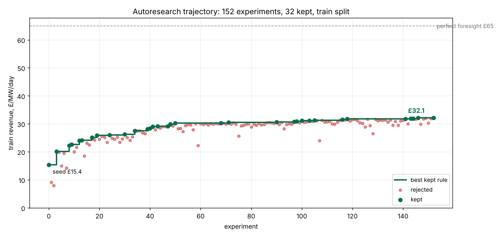
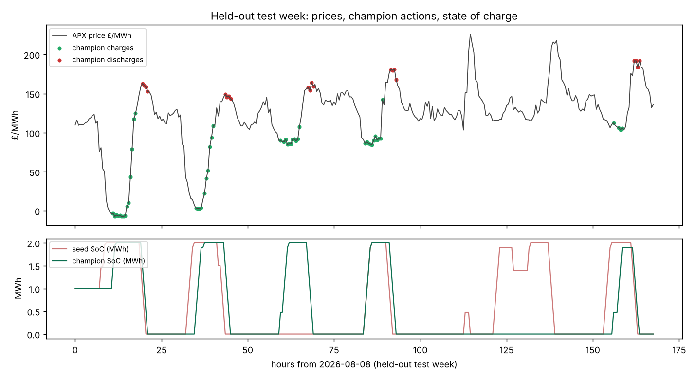

# Moonfire: autoresearch for battery dispatch

Entry for the Moonfire Ventures Hack (Cambridge Compute Co. · AIDDA). Brief: [context/moonfire-ventures-hack.md](context/moonfire-ventures-hack.md).

**One line:** an autoresearch pipeline that continuously improves the dispatch rule of a grid battery on real GB electricity prices, and promotes a new rule only when it also wins on months the search never saw.

## The use case

Grid batteries earn money by buying power when it is cheap and selling it when it is dear. Every half hour the dispatch rule decides: charge, discharge, or wait, knowing only past prices. The quality of that rule is the whole business.

We are the **optimiser firm** in this scenario: the company that runs dispatch for battery owners under a revenue share, floor or toll, the way Tesla Autobidder, Octopus Kraken Flex, Habitat Energy, Flexitricity and EDF PowerShift do in GB. An optimiser's margin is the gap between what its rule captures and what a rival's would.

The numbers (sources in [context/research/](context/research/)):

- GB has **8.5 GW / 14.4 GWh** of batteries (Modo, Q3 2026), heading for 20+ GW by 2029 and a NESO need of 23–27 GW by 2030.
- The Modo GB index hit **£99k/MW/year in September 2026**, with wholesale arbitrage a record **£68k** of it, the highest wholesale share ever. Arbitrage is now the main revenue stream, which is what our policy trades.
- The best asset earned **~42% more than the index** that month, and Modo attributes the spread between optimisers mainly to trading strategy, not cycling harder. Fleet-wide, each percentage point of capture is worth ~£5.5m/year.
- The industry metric is **Percentage of Perfect (PoP)**: realised revenue over the perfect-foresight maximum. Observed optimisers land at **60–80%**; no vendor publishes a reproducible figure, and Modo notes that each picks its own benchmark or its best backtest. A fixed evaluator with a walk-forward split and a held-out test window is the credible version of that pitch.

Today the rule is improved by humans: a daily expert review at Fluence, trading desks at Habitat and EDF, operator-set parameters at Tesla. Job ads at Habitat, Entrix, YUSO and Axpo all describe the same step: "build backtesting and parameter-optimisation pipelines." Nobody describes an automated loop that rewrites the dispatch rule and is gated out of sample. That is the step this pipeline automates.

## The pipeline

```
fetch_prices.py ──> data/prices.csv ──> split by time (train / val / test)
                                               │
        search loop (pluggable) edits policy.py │
                 │  calls                       ▼
                 └──────────> evaluate.py ──> JSON {score, ci95, pct_of_oracle, cycles, error}
                                               │
                           gate.py: beats champion on val?  ──yes──> champion/policy.py + results/
```

| File | Role |
|---|---|
| `fetch_prices.py` | Half-hourly APX market index prices from Elexon's open BMRS API. No key. Drops partial edge days, interpolates untraded periods. |
| `battery.py` | Asset spec (1 MW / 2 MWh, 90% round trip, £10/MWh degradation), simulator, time splits, exact perfect-foresight oracle. **The loop cannot edit this.** |
| `policy.py` | `decide(past_prices, soc, period, weekday) -> MW`. **The only file the loop edits.** |
| `evaluate.py` | Scores a policy file on a split in a guarded subprocess. The single command every loop driver calls. 0.2 s per run. |
| `baselines.py` | Do-nothing, fixed time-of-day schedule, seed rule, oracle, on every split. |
| `gate.py` | Champion/challenger promotion on val; scores test once; writes `results/`. |
| `program.md` | Instructions for the search agent. |
| `seed_policy.py` | Frozen copy of the starting rule, for the report. |
| `loop_log.md` | Every experiment the search ran: idea, train score, kept or not. Kept ones are also git commits. |
| `champion/policy.py` | The rule `gate.py` promoted. Identical to `policy.py` at the end of this run. |
| `results/` | `results/results.md` and `results.json` (the table below), `loop.png` (search trajectory), `test_week.png` (held-out week). |
| `plot_loop.py`, `plot.py` | Draw `results/loop.png` from the log and `results/test_week.png` from the champion. |
| `dashboard/` | Next.js dashboard over the same outputs; `dashboard/scripts/build_data.py` reads train only and takes val/test from `results/`. |
| `data/prices.csv`, `data/SOURCES.md` | The year of prices used here, and other open price APIs (GB imbalance, Germany, NEM, ERCOT) the fetcher can be pointed at. |
| `context/` | The hack brief, our decision log, and the market, product and workflow research behind the use case. |
| `PITCH.md`, `presentation/` | Three-minute pitch, numbers and judge Q&A; slide deck. |

The pipeline has zero dependencies beyond Python 3.12. Plots add matplotlib; the dashboard is Node. `uv sync && uv run python baselines.py` reproduces the train/val/test scores below.

### The search loop is a black box

The loop only needs to do two things: edit `policy.py`, and run `uv run python evaluate.py policy.py --split train`. In this run it is a Claude Code agent following `program.md` (Karpathy-style: propose, score, keep if better, commit). OpenEvolve, LoongFlow or any other framework drops in by writing a driver that calls the same command. Everything judges should care about (task contract, evaluator, split, gate) is independent of that choice.

## The evaluator

**Headline:** net revenue in £/MW/day over the window, with a 95% bootstrap confidence interval over days.
**Secondary:** Percentage of Perfect (PoP), the industry's name for revenue over the perfect-foresight optimum.

- **The ceiling is exact.** With 1 MW and half-hour steps, stored energy moves in 0.5 MWh units, so a five-state dynamic programme over the window gives the best any policy could do knowing every future price. It runs in a millisecond.
- **Why £/MW/day leads.** "% of perfect foresight" scales with volatility, not skill: a calm month has a tiny denominator and bad trades can push it negative. The later windows here were two to three times more volatile than train, so both numbers are shown.
- **Costs are inside the simulator**, not the policy: efficiency losses, degradation per MWh moved, power and charge limits. The policy returns a request; the simulator clips it and does the accounting. It cannot misreport.

### Leakage and overfitting guards (each verified with a deliberately bad policy)

| Guard | Mechanism |
|---|---|
| No lookahead | Policy is called step by step with `prices[:t]`. The current period's price is a settlement price, known only after the fact. |
| No test peeking | Split by time. The loop runs only `--split train`. `gate.py` reads val for promotion and test exactly once. |
| No hard-coded calendars | Literal dates rejected by regex before the policy is loaded. |
| No smuggled data | AST check: only `math` may be imported. |
| Crash, NaN, hang | Score 0, error text returned to the loop. 30 s subprocess timeout. |
| Over-rating | Simulator clips to 1 MW and SoC limits. |
| Thrashing | Cycle count reported; degradation cost already penalises it. |

### Where it can still mislead

- **Regime shift.** Train is Oct 2025–May 2026; test is Aug–Oct 2026. Gas, wind and interconnector conditions differ. A train gain that fails on test is reported, not hidden.
- **Single market.** The model trades the realised market index only. Real operators also run day-ahead, frequency response and the Balancing Mechanism, and use forecast feeds. Absolute £ here is a floor, not a forecast.
- **Market impact** is assumed zero at 1 MW.
- **One year of data** is one price regime. Practitioners re-tune control parameters at least quarterly (WattClarity); that is why deployment re-runs the search on a schedule.
- **Degradation.** We charge a flat £10/MWh of throughput. Practitioners report that ageing costs change the answer a lot (DFKI), and warranty throughput limits are cumulative; a richer cost model slots into `battery.py` without touching the loop.
- **Search overfits backtests.** This is the documented failure of LLM-evolved trading strategies (MadEvolve, arXiv 2605.23007, assesses p-hacking; the EV-dispatch LLM-evolution paper had no held-out split). The val gate and the once-only test read are our answer, and the results table shows the train/test gap rather than hiding it.

## Results

Champion promoted on val (£61.62 vs seed £46.90), then scored once on the held-out test window (1 Aug to 14 Oct 2026). £/MW/day, 1 MW / 2 MWh asset.

| policy | train £/MW/day | val £/MW/day | test £/MW/day | test 95% CI | test % of oracle | test cycles |
|---|---|---|---|---|---|---|
| do_nothing | 0.0 | 0.0 | 0.0 | 0.0–0.0 | 0.0 | 0.0 |
| fixed_schedule | 11.13 | 9.1 | 34.07 | 17.21–52.62 | 22.3 | 71.0 |
| seed | 15.39 | 46.9 | 55.11 | 20.93–87.6 | 36.1 | 50.6 |
| champion | 32.42 | 61.62 | 70.64 | 40.59–101.55 | 46.3 | 33.8 |
| perfect foresight | 64.9 | 115.2 | 152.5 | – | 100 | – |

On three months the search never saw, the champion earns **£70.64/MW/day against the seed's £55.11 (+28%)**, at **46.3% of perfect foresight**, while cycling a third less. Train roughly doubled (£15.4 to £32.4); the smaller test gain is the honest out-of-sample number.





## Deployment

A weekly scheduled job runs the whole cycle: refetch prices, re-run the search on a rolling window, gate on the newest month, and open a pull request containing the new `policy.py` and its report. The quant team reviews the diff (the rule is a few dozen lines of plain Python with no dependencies, which is how dispatch rules are written anyway), shadow-runs the challenger beside live dispatch, then switches.

- **Different asset:** change the spec in `battery.py`.
- **Different market** (ERCOT, NEM, Germany): change `fetch_prices.py`; endpoints for each are listed in [data/SOURCES.md](data/SOURCES.md).
- **Different search framework:** write a driver that calls `evaluate.py`.
- **Cost:** evaluation is 0.2 s; the LLM is the only expense, and it is bounded by iteration count.

## Reproduce

```
uv sync
uv run python fetch_prices.py 2025-10-01 2026-10-15
uv run python baselines.py
# run your search loop of choice against policy.py, then
uv run python gate.py policy.py
uv run --with matplotlib python plot_loop.py
uv run --with matplotlib python plot.py

# dashboard
uv run python dashboard/scripts/build_data.py
cd dashboard && npm install && npm run dev      # http://localhost:3000
```
